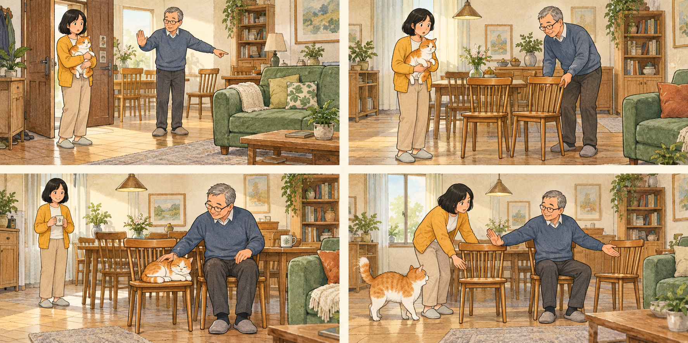
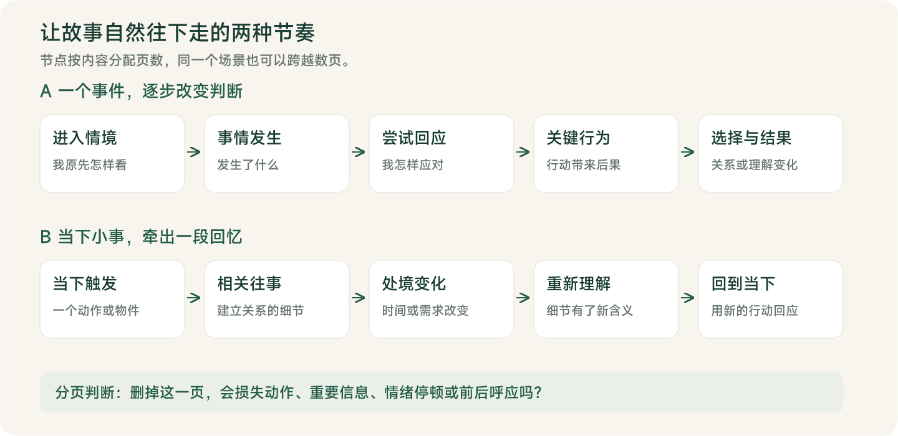

# 故事漫画脚本

<a id="contents"></a>
## 目录

1. [安装使用](#install)
2. [快速开始](#quick-start)
3. [适用场景](#use-cases)
4. [四页完整示例](#example)
5. [故事分页方法](#rhythm)
6. [修改与保存](#revision)
7. [接入绘图流程](#drawing)
8. [常见问题](#faq)
9. [技能文件结构](#structure)
10. [配图与来源](#sources)

---

**把一句灵感，写成可以逐页绘制的完整故事。**

`story-comic-script` 将一句话、真实经历、故事提纲或已有长稿，整理成适合连续翻阅的中文漫画脚本。你会得到标题、逐页上图文字和简短画面说明；页数由故事需要决定，默认最多 18 页。

**一句话就能开始 · 每页一个主要画面 · 保留你的原话与结局 · 生活与悬疑皆可**

[离线 HTML 说明](使用说明.html) · [技能规则](../SKILL.md)

<a id="install"></a>
## 1. 安装使用

通过 [Skills CLI](https://github.com/vercel-labs/skills) 安装（需要 Node.js 22.20 或更新版本）：

```bash
npx skills add hongshuai1991/story-comic-script
```

按提示选择要安装到的 Agent。默认安装到当前项目；需要在多个项目使用时，可以选择全局安装：

```bash
npx skills add hongshuai1991/story-comic-script -g
```

也可以下载本仓库，保留 `SKILL.md`、`agents/` 和 `references/` 的完整目录，再交给你使用的 Agent 安装。安装后，直接在聊天中点名 `story-comic-script` 并提供故事素材。

<a id="quick-start"></a>
## 2. 快速开始

在已经加载这个 skill 的聊天中，直接发出下面的请求：

```text
使用 $story-comic-script：
爸爸总嫌我养的猫掉毛，后来却在自己身边给它留了一把椅子。
写成一个轻松、温暖的原创生活故事，4 页左右。
```

只有第一句故事灵感，也可以开始。页数、人物、语气等信息按需补充；收到一句话或粗提纲后，skill 会直接完成初稿。

你通常会收到：**1 个推荐标题、2 个备选标题、简短创作说明、本篇页数，以及第 01—N 页的完整脚本。**


### 2.1 把要求说清楚，结果更贴近你

下面是一份可以直接复制的请求模板。只保留你关心的项目即可。

```text
使用 $story-comic-script，把下面的素材写成完整漫画脚本。

素材：……
性质：原创虚构 / 真实经历 / 已授权改编
页数：按故事需要，最多 18 页 / 指定为……页
视角与语气：第一人称，口语，轻松 / 温暖 / 直接 / 悬疑……
必须保留：人物关系、关键事件、这句原话……
结局：……
输出：每页上图文字＋简短画面说明
```

<a id="use-cases"></a>
## 3. 适用场景

| 你的素材 | 可以直接提出的要求 |
| --- | --- |
| 一句话灵感 | “围绕这件小事扩写成一个完整故事，页数自然安排。” |
| 亲情、友情、爱情或成长经历 | “保留当时的感受，写出具体互动和关系变化。” |
| 童年回忆、日常趣事 | “口语一点，把笑点落在动作和对白上。” |
| 悬疑、诡异短篇 | “保留最后那个矛盾画面，线索逐页揭示，结尾停在那里。” |
| 已有散文或长稿 | “保留主线和关键原话，压缩背景，拆成 12 页以内。” |
| 已有漫画脚本 | “修改第 6—8 页，核对与前后页的衔接。” |

### 3.1 真实经历怎么处理

说明“这是我的亲历”或“这是真实投稿”，skill 会保留事实，润色表达、拆分动作并整理衔接。涉及疾病、死亡、背叛、和解等重大剧情变化，需要依据你提供的事实或明确的改编授权；缺少影响主线的信息时，会集中询问关键问题，同时整理已有素材。

### 3.2 悬疑故事怎么处理

你有意保留的悖论、异常结果和开放结尾，会作为故事效果保留。例如“明明救下了妈妈，回家却看见母女两张遗照”，扩写会围绕事件经过、细节和揭示顺序展开，结尾含义依照你的设定。画面说明也会按页控制线索出现的时机。

<a id="example"></a>
## 4. 四页完整示例



*原创配图示意：展示脚本接入绘图后的可能效果。这个 skill 的交付范围是文字脚本。*

**输入素材**

> 爸爸总嫌我养的猫掉毛，后来却在自己身边给它留了一把椅子。写成一个轻松、温暖的原创生活故事，4 页左右。

**推荐标题：爸爸给猫留的座位**  
备选标题：① 那把谁也不能坐的椅子 ② 爸爸说，猫坐这儿

**创作说明：** 围绕“嘴上嫌弃，行动上接纳”展开，补充拖椅子、摸猫和护座三个日常动作。以下为原创虚构示例，共 4 页。

### 第01页

**上图文字**

我把猫带回家那天，爸爸站得远远的。  
爸爸：「掉毛，别往沙发上放。」

**画面说明**

客厅门口，我抱着橘白猫，爸爸隔着两步指向沙发，神情有些戒备；餐桌边放着空木椅。

### 第02页

**上图文字**

我刚准备抱它回房间，他却从餐桌边拖来一把椅子。  
爸爸：「放这儿。」

**画面说明**

同一间客厅，爸爸把木椅拖到自己座位旁；我仍抱着猫，停下脚步看他。

### 第03页

**上图文字**

猫刚蜷好，他就伸手摸了摸它的脑袋。  
爸爸：「它叫什么来着？」

**画面说明**

橘白猫蜷在木椅上，爸爸坐在旁边，轻轻摸着猫的头；我在一旁看着。

### 第04页

**上图文字**

后来我想坐那把椅子，爸爸伸手拦了一下。  
爸爸：「那是它的，你坐我这儿。」

**画面说明**

几天后，我伸手拉那把木椅，爸爸轻轻挡住，同时示意自己的座位；橘白猫正走向它的椅子。

### 4.1 一页里，两部分分别怎么用


| 内容 | 用途 | 默认写法 |
| --- | --- | --- |
| 页码 | 确定翻阅顺序 | 从第 01 页连续编号到第 N 页 |
| 上图文字 | 直接用于漫画排版 | 约 25—60 个可见字符、2—5 个短句；根据表达需要调整，通常不超过 80 个字符 |
| 对白 | 呈现人物实际说出的话 | 关键处使用，标明说话人；角色标签是制作标记，可按版式处理 |
| 画面说明 | 交代这一页画什么 | 1—2 句，写人物、场景、动作、表情与关键物件；必要时说明景别 |

文字密度是手机阅读的创作目标，包含旁白、对白、心理文字和标点；页码与画面说明不计入。情绪停顿页可以更短，必要叙述可以略长。

<a id="rhythm"></a>
## 5. 故事分页方法

分页围绕“情境、事件、回应和结果”安排。先找最有分量的场景，再确定页数；每一页带来新的动作、信息、关系变化、理解或必要的情绪反应。



| 节奏 | 展开方式 | 常见素材 |
| --- | --- | --- |
| 一个事件改变判断 | 进入情境 → 事情发生 → 尝试回应 → 关键行为 → 选择与结果 | 一次相处、争执、误会、趣事 |
| 当下小事牵出回忆 | 当下触发 → 相关往事 → 处境变化 → 重新理解 → 回到当下 | 亲情、友情、成长、怀旧 |

**页数按内容决定。** 默认最多 18 页，12 页、15 页或更短都可以。你也可以明确指定页数；第 01 页默认直接开始讲故事，可兼作封面，单独封面的安排需要在请求中说明，并纳入约定页数。

故事较薄时，会展开需求、尝试、阻碍、选择和后果；故事较满时，会压缩背景与支线，保留使结局成立的因果。结尾落在人物行动、关系结果或具体感受上，语气和判断依照你的要求。

<a id="revision"></a>
## 6. 修改与保存

| 你想调整什么 | 可直接复制的请求 |
| --- | --- |
| 对白更像日常说话 | “把对白改得更口语，保留人物原来的态度和判断。” |
| 节奏更紧凑 | “压缩到 10 页，保留关键事件，合并重复感受和背景。” |
| 保留原定结局 | “只调整前面的铺垫，最后一页的异常画面和原话保持原样。” |
| 修改指定页面 | “重写第 4—6 页，其他页尽量沿用，并核对人物动作和道具衔接。” |
| 只取上图文案 | “只要每页上图文字，保留页码，去掉画面说明和额外分析。” |
| 调整画面安排 | “第 5 页改成两格，写清前后动作；其余每页一个主要画面。” |
| 保存为文件 | “保存为《爸爸给猫留的座位-脚本.md》，放在我指定的目录，另存新文件。” |

聊天里默认交付完整脚本。需要文件时，请说明保存位置和文件名；已有原稿时，可以明确要求另存。指定页的修改若影响其他页面，会简短说明并给出连带修改。

<a id="drawing"></a>
## 7. 接入绘图流程

1. **确定脚本。** 检查人物关系、关键原话、结局和页数是否符合你的想法。
2. **准备绘制信息。** 在你的绘图流程中补充画风、人物外貌、服装、画幅与排版要求。
3. **逐页绘制与排版。** 用画面说明确定场景与动作，用上图文字完成漫画文案。
4. **连起来检查。** 看称呼、时间、地点和物件状态是否连续，线索是否在正确的页面揭示。

这个 skill 的画面说明聚焦叙事，生图参数、模型提示词和完整人物外貌设定由后续流程补充。

需要继续制作彩铅风格漫画时，可以配合[彩铅手绘故事漫画 skill](https://github.com/hongshuai1991/colored-pencil-story-comic)，继续完成人物设定、连续配图和中文排版。

<a id="faq"></a>
## 8. 常见问题

### 8.1 只有一句话，也能写吗？

可以。原创素材会按最贴合原意的方向补足过程，直接交付完整初稿。你指定的人物关系、原话、结局和判断会优先保留。

### 8.2 可以写得直接一点，保留不原谅的态度吗？

可以。人物的口语、直接评价及符合素材的粗口都可以保留，情绪依照原意处理。你可以明确要求“保留我的判断”“结尾就停在离开这里”。

### 8.3 可以固定成 8 页、12 页或指定其他页数吗？

可以，直接说明总页数和封面安排。默认页数按内容确定，最多 18 页；你明确指定其他页数时，以你的要求为准。

### 8.4 会自动画图或发布到小红书吗？

交付到文字脚本结束。绘图、图片排版及发布可以继续使用你已有的工具和流程。

### 8.5 故事一定要有大反转吗？

节奏由素材决定。一个小笑点、关系中习惯的变化，或重新理解一段回忆，都能构成完整故事。

<a id="structure"></a>
## 9. 技能文件结构

```text
story-comic-script/
├── README.md                       顶部目录与图文使用说明
├── SKILL.md                        主规则与交付约定
├── agents/
│   └── openai.yaml                  显示名称与默认请求
├── references/
│   ├── story-rhythm.md              叙事节奏参考与分页判断
│   └── original-example.md          完整 18 页原创脚本示例
└── docs/
    ├── 使用说明.md                  Markdown 说明
    ├── 使用说明.html                离线 HTML 说明
    └── 配图/                       示例插图、PNG 预览与 SVG 源图
```

进一步查看：[主规则](../SKILL.md) · [叙事节奏参考](../references/story-rhythm.md) · [18 页原创脚本示例](../references/original-example.md)

<a id="sources"></a>
## 10. 配图与来源

本文的四页故事、图解与插图为本项目制作。插图展示脚本接入绘图后的可能效果，本 skill 的交付范围为文字脚本。

文档组织参考 [baoyu-skills 中文 README](https://github.com/JimLiu/baoyu-skills/blob/main/README.zh.md) 的功能介绍、调用示例与效果预览方式。叙事节奏的参考范围与来源见[叙事参考](../references/story-rhythm.md)，完整原创长篇脚本见[18 页示例](../references/original-example.md)。

文档更新：2026 年 11 月 2 日。
